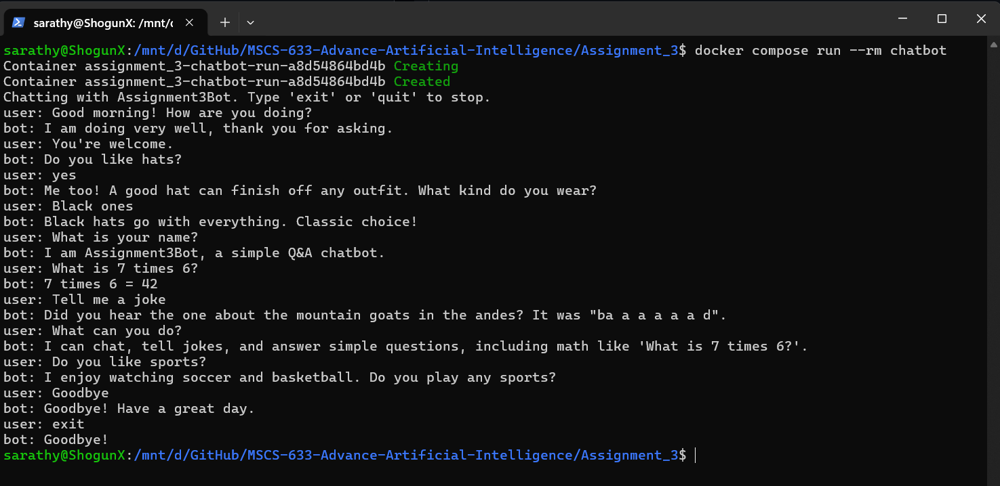

# Simple Q&A Chatbot

Hands-On Assignment 3 — Advanced Artificial Intelligence (MSCS-633-M20)
University of the Cumberlands

A terminal chatbot built with Python, [Django](https://www.djangoproject.com/), and [ChatterBot](https://docs.chatterbot.us/). ChatterBot learns from collections of known conversations and replies with the closest match. Django stores what it learns and provides the terminal client. Everything runs in Docker, so nothing needs to be installed except Docker.

## Output



The sample dialog from the brief, followed by a few more questions ([output/sample_chat.txt](output/sample_chat.txt)):

```text
Chatting with Assignment3Bot. Type 'exit' or 'quit' to stop.
user: Good morning! How are you doing?
bot: I am doing very well, thank you for asking.
user: You're welcome.
bot: Do you like hats?
user: yes
bot: Me too! A good hat can finish off any outfit. What kind do you wear?
user: Black ones
bot: Black hats go with everything. Classic choice!
user: What is 7 times 6?
bot: 7 times 6 = 42
user: Tell me a joke
bot: Did you hear the one about the mountain goats in the andes? It was "ba a a a a a d".
user: exit
bot: Goodbye!
```

## Try it

| Option | What you need | How |
| --- | --- | --- |
| In the browser | A GitHub account | [](https://codespaces.new/Sarathyponnapalli/MSCS-633-Advance-Artificial-Intelligence?devcontainer_path=.devcontainer/assignment3/devcontainer.json), then run `python /app/manage.py chat` in the terminal |
| Prebuilt image | Docker | `docker run -it --rm ghcr.io/sarathyponnapalli/assignment3-chatbot:latest` |
| Demo transcript | Nothing | Open the latest [Assignment 3 chatbot workflow run](https://github.com/Sarathyponnapalli/MSCS-633-Advance-Artificial-Intelligence/actions/workflows/assignment3-chatbot.yml) and read its summary |

## Setup and usage

From this folder:

```bash
docker compose build
docker compose run --rm chatbot
```

Without Compose:

```bash
docker build -t assignment3-chatbot .
docker run -it --rm assignment3-chatbot
```

The bot is trained while the image builds, so the chat starts straight away. Type `exit` or `quit` (or press Ctrl+C) to leave. To change what the bot knows, edit `chatbot/training_data.py` and rebuild.

## How it works

1. **Training** (`python manage.py train`, run during the image build) loads 15 sections of the official ChatterBot English corpus with `ChatterBotCorpusTrainer`, then the project's own conversations with `ListTrainer`. Those include the sample dialog from the brief. Each line is learned as the response to the line before it.
2. **Chatting** (`python manage.py chat`) sends each message to two logic adapters, and the reply with the highest confidence wins:
   - `BestMatch` finds the known statement closest to the input and returns the response learned for it. If nothing is close enough, it picks one of a few fallback replies.
   - `MathematicalEvaluation` answers arithmetic such as "What is 7 times 6?".
3. **Storage:** ChatterBot's `DjangoStorageAdapter` keeps statements in a SQLite database through Django's ORM. The chat runs read-only, so the bot doesn't learn from what you type and its replies stay consistent.

A GitHub Actions workflow ([.github/workflows/assignment3-chatbot.yml](../.github/workflows/assignment3-chatbot.yml)) builds the image on every push and checks that the sample dialog still works. It posts a chat transcript on the run page and publishes the prebuilt image.

## Dependencies

Listed in [requirements.txt](requirements.txt):

- Django 5.2 (LTS)
- ChatterBot 1.2.15 and chatterbot-corpus 1.2.2
- spaCy `en_core_web_sm`, used by ChatterBot to normalize text
- `preshed` pinned to 3.0.10, because 3.0.14 makes spaCy 3.8 crash with `OverflowError` when loading the model

## Project structure

```text
Assignment_3/
├── README.md
├── manage.py                    # Django entry point
├── chatbot_project/settings.py  # Django settings (SQLite + ChatterBot app)
├── chatbot/
│   ├── bot.py                   # ChatBot configuration
│   ├── training_data.py         # corpus sections and custom conversations
│   └── management/commands/
│       ├── train.py             # python manage.py train
│       └── chat.py              # python manage.py chat (terminal client)
├── requirements.txt             # dependency manifest
├── Dockerfile                   # container build (installs, migrates, trains)
├── compose.yaml                 # docker compose run --rm chatbot
└── output/
    ├── chatbot_screenshot.png   # screenshot of a chat session
    └── sample_chat.txt          # sample output as text
```

## Author

Parthasarathi Ponnapalli
