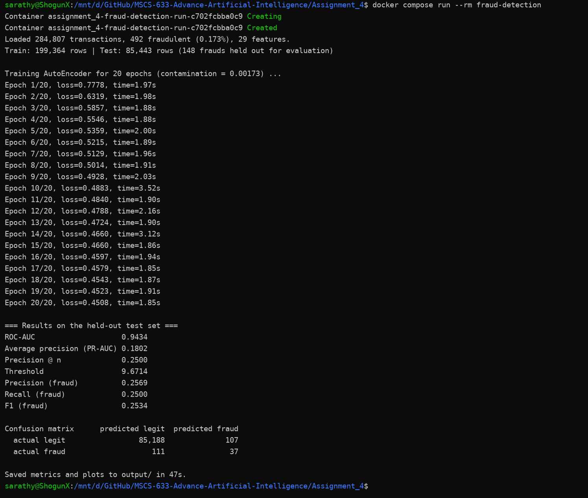
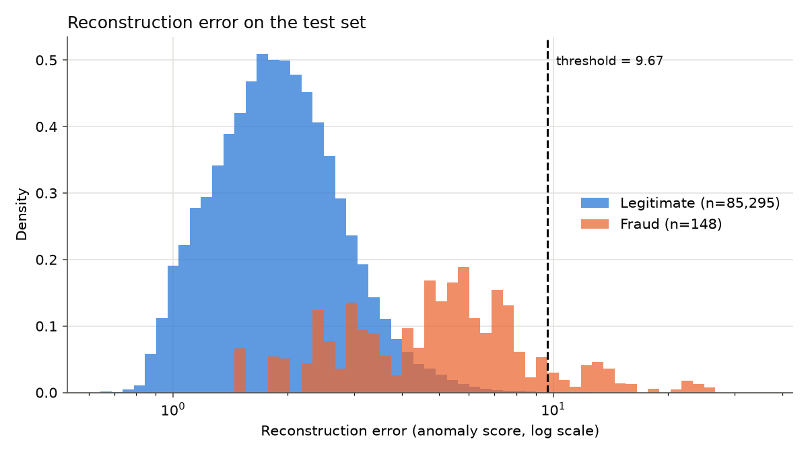
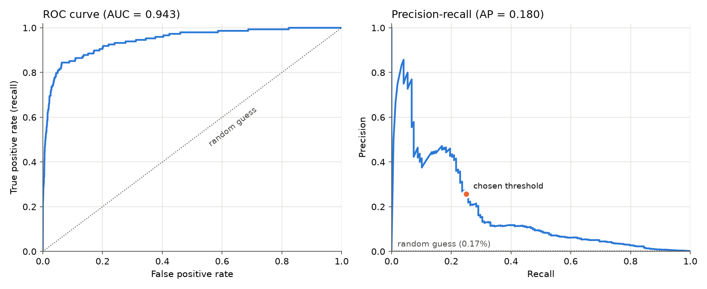
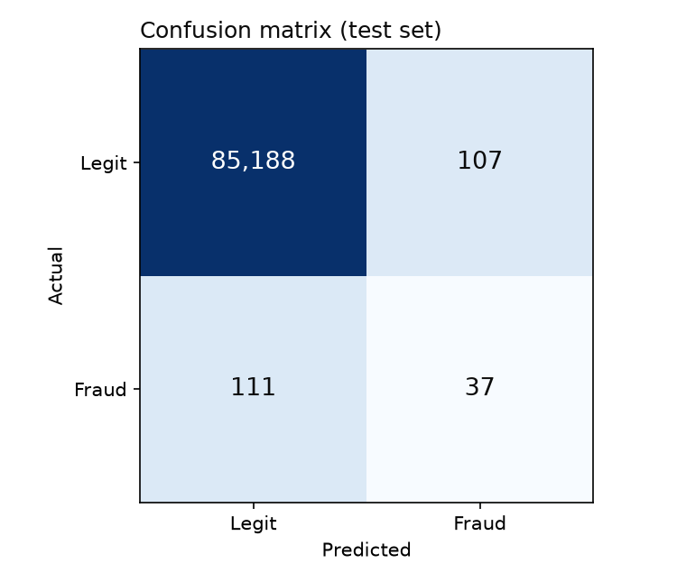
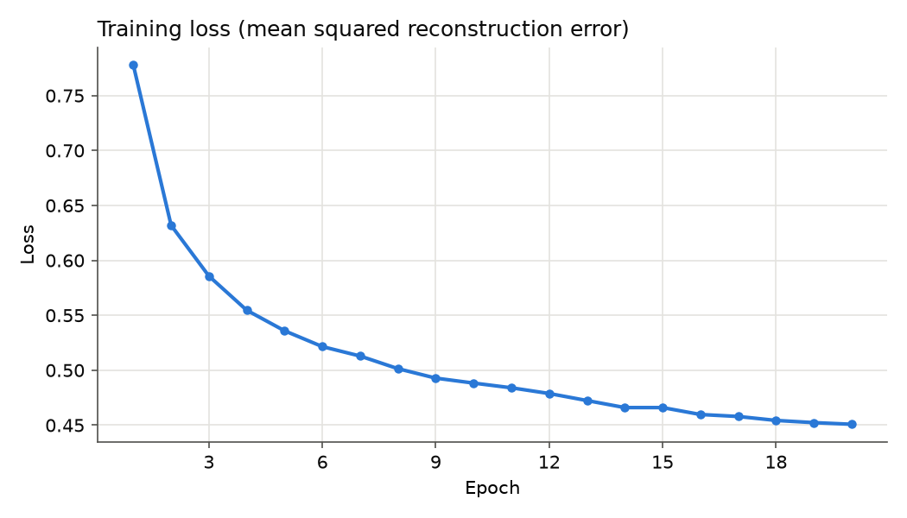

# Fraud Detection with a PyOD AutoEncoder

Hands-On Assignment 4 — Advanced Artificial Intelligence (MSCS-633-M20)
University of the Cumberlands

Unsupervised credit card fraud detection with the `AutoEncoder` from [PyOD](https://pyod.readthedocs.io/) and the anonymized [Kaggle credit card transactions dataset](https://www.kaggle.com/datasets/mlg-ulb/creditcardfraud). The AutoEncoder learns to rebuild ordinary transactions. Transactions it rebuilds badly, with a high reconstruction error, are flagged as likely fraud. The fraud labels are used only to grade the detector, never to train it. Everything runs in Docker, so nothing needs to be installed except Docker.

## Output



Results on the held-out test set (85,443 transactions, 148 of them fraud), from [output/metrics.json](output/metrics.json):

| Metric | Value | What it means |
| --- | --- | --- |
| ROC-AUC | 0.943 | A random fraud scores higher than a random legitimate transaction 94% of the time |
| Average precision (PR-AUC) | 0.180 | About 100× better than random ranking, which scores 0.0017 at this fraud rate |
| Precision @ n | 0.250 | A quarter of the 148 highest-scoring transactions are fraud |
| Precision / recall at the threshold | 0.257 / 0.250 | Flags 144 transactions: 37 real frauds caught, 107 false alarms |

Accuracy is 99.7%, but that number means little: a model that never flags anything scores 99.8% here. ROC-AUC and PR-AUC show how well the score separates fraud from legitimate transactions.

| Reconstruction error by class | ROC and precision-recall curves |
| --- | --- |
|  |  |
| **Confusion matrix** | **Training loss** |
|  |  |

Most frauds have a far higher reconstruction error than legitimate transactions, which is why ROC-AUC is high. The threshold sits where PyOD expects 0.17% of transactions to be outliers, so it flags only the most extreme cases. Moving it left catches more fraud at the cost of more false alarms. On the ROC curve, roughly 80% of frauds are caught at a 5% false positive rate.

The full run log is in [output/results.txt](output/results.txt).

## Setup and usage

From this folder:

```bash
docker compose build
docker compose run --rm fraud-detection
```

The first run downloads the dataset (150 MB) into `data/`. Later runs reuse it. A run takes under a minute on a laptop CPU. Results and plots are written to `output/`, which is mounted from the host.

Options:

```bash
docker compose run --rm fraud-detection python fraud_detection.py --epochs 40 --batch-size 512
```

| Flag | Default | Meaning |
| --- | --- | --- |
| `--epochs` | 20 | Training epochs |
| `--batch-size` | 256 | Mini-batch size |
| `--test-size` | 0.3 | Share of transactions held out for evaluation |
| `--seed` | 42 | Random seed (split, weights, batching) |
| `--data` | `data/creditcard.csv` | Dataset path (downloaded if missing) |
| `--output` | `output` | Folder for metrics, plots and the log |

Runs are reproducible: the same seed gives the same numbers.

## How it works

1. **Data:** 284,807 European card transactions from September 2013, 492 of them fraud (0.17%). Columns `V1`–`V28` are PCA components that hide the original features, plus `Time`, `Amount`, and the `Class` label. Kaggle needs a login, so the script downloads the identical file from a public TensorFlow mirror. A copy you download from Kaggle into `data/creditcard.csv` is used instead if present.
2. **Preparation:** `Time` is dropped, since it is only seconds since the first transaction. `Amount` is log-transformed because a few large purchases would otherwise dominate. `Class` is set aside. A stratified 70/30 split keeps the same fraud share in both parts. PyOD standardizes the features.
3. **Model:** a PyOD `AutoEncoder` with layers 29 → 64 → 32 → **16** → 32 → 64 → 29, with ReLU, batch normalization, dropout 0.1 and Adam (learning rate 0.001). It is trained for 20 epochs on the training transactions **without labels** to minimize mean squared reconstruction error. The 16-unit bottleneck forces the network to learn what typical transactions look like.
4. **Scoring:** each test transaction's reconstruction error is its anomaly score. PyOD's `contamination` (0.17%, the training fraud rate) sets the threshold at the training-score percentile above which transactions are labeled fraud. This is the only place the labels' fraud rate is used, and it doesn't affect training.
5. **Evaluation:** the scores are compared with the real labels using ROC-AUC, average precision, precision @ n, the confusion matrix and a classification report.

## Dependencies

Listed in [requirements.txt](requirements.txt):

- PyOD 3.6.8 (AutoEncoder), on PyTorch 2.15 (CPU-only build, to keep the image small)
- `tqdm`, which PyOD's deep-learning models import without declaring it
- NumPy, pandas, scikit-learn (split and metrics), Matplotlib (plots)

## Project structure

```text
Assignment_4/
├── README.md
├── Instructions.Md            # assignment brief
├── fraud_detection.py         # the experiment: load, prepare, train, evaluate, plot
├── requirements.txt           # dependency manifest
├── Dockerfile                 # container build
├── compose.yaml               # docker compose run --rm fraud-detection
├── data/                      # creditcard.csv, downloaded on first run (not committed)
└── output/
    ├── experiment_output.png  # console output of a run
    ├── results.txt            # the same output as text
    ├── metrics.json           # all metrics
    ├── reconstruction_error.png
    ├── roc_pr_curves.png
    ├── confusion_matrix.png
    └── training_loss.png
```

## Dataset credit

Andrea Dal Pozzolo, Olivier Caelen, Reid A. Johnson and Gianluca Bontempi. *Calibrating Probability with Undersampling for Unbalanced Classification.* IEEE Symposium Series on Computational Intelligence and Data Mining (CIDM), 2015. Collected by Worldline and the Machine Learning Group of ULB (Université Libre de Bruxelles). Distributed on Kaggle under the Open Database License.

## Author

Parthasarathi Ponnapalli
